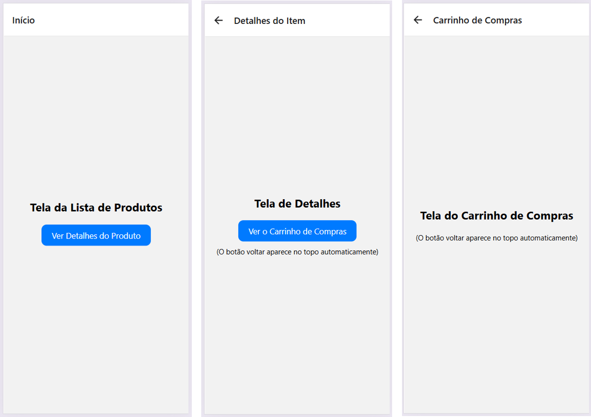

# 09-react-native

## Exercícios: Navegação por Stack

Os exercícios usam como ponto de partida o fluxo de produtos já presente nesta prática: Início, Detalhes e Carrinho. Implemente e teste as mudanças em `meu-app/app/`.

### 1. Abrir os detalhes de um produto

Na tela inicial, transforme o botão atual em uma lista com pelo menos três produtos. Ao tocar em um produto, navegue para a tela de detalhes usando `router.push` e envie o identificador do produto como parâmetro.

Na tela de detalhes, leia o parâmetro com `useLocalSearchParams` e mostre o nome e o preço correspondentes ao produto selecionado.

**Critério:** cada item da lista abre seus próprios dados, e a tela de detalhes continua permitindo voltar para a lista.

### 2. Explorar a pilha de navegação

Na tela de detalhes, adicione um botão para abrir o carrinho com `router.push`. No carrinho, inclua uma ação para voltar à tela anterior com `router.back`.

Teste também o botão de voltar do cabeçalho e o botão voltar do dispositivo ou navegador. Observe como cada ação percorre o histórico do stack.

**Critério:** ao abrir o carrinho a partir dos detalhes, voltar retorna aos detalhes; voltar novamente retorna à lista.

### 3. Substituir a tela atual

Crie uma tela de confirmação de pedido. Depois da ação de finalizar compra no carrinho, use `router.replace` para exibir a confirmação sem manter o carrinho como a tela anterior.

**Critério:** depois da confirmação, voltar não deve reabrir o carrinho. Compare esse comportamento com `router.push` e explique a diferença entre empilhar e substituir uma rota.

### 4. Configurar as telas do Stack

No arquivo `_layout.tsx`, configure opções individuais para as telas usando `Stack.Screen`: defina títulos mais descritivos para Início, Detalhes e Carrinho e oculte o cabeçalho apenas na tela de confirmação.

**Critério:** cada tela apresenta as opções esperadas no cabeçalho, e a confirmação não exibe cabeçalho. Confira se a navegação de retorno continua funcionando nas demais telas.

### 5. Fluxo de Login (Navegação Linear Básica)

**Objetivo**: compreender a pilha padrão (navigate), substituição de telas (replace) e a remoção do botão de retorno nativo.

• Cenário: um fluxo simples de autenticação em que o usuário não pode retornar à tela de login após entrar no app.

• Requisitos:

	1. Crie duas telas: Login e Home.

	2. Na tela Login, insira um botão "Entrar". Ao clicar, use navigation.replace('Home') em vez de navigate.

	3. Na tela Home, verifique se o botão físico/virtual de "Voltar" (no topo ou no sistema operacional) desapareceu, impedindo o usuário de retornar ao Login deslogado.

	4. Adicione um botão "Sair" na Home que faz o caminho inverso, usando replace('Login').

### 6: Catálogo de Produtos (Passagem de Parâmetros e Título Dinâmico)

**Objetivo**: enviar dados de uma tela para outra (route.params) e alterar o cabeçalho dinamicamente.

• Cenário: uma lista de produtos em que ao clicar em um item abre os detalhes específicos dele.

• Requisitos:

	1. Crie duas telas: ListaProdutos e DetalhesProduto.

	2. Na ListaProdutos, renderize uma lista com pelo menos 3 itens (ex: Camiseta, Tênis, Boné). Cada item deve ser um botão que redireciona para DetalhesProduto passando um objeto de dados (ex: { nome: 'Tênis', preco: 'R$ 299,00', descricao: 'Tênis de corrida confortável' }).

	3. Na tela DetalhesProduto, recupere os dados usando route.params e exiba o preço e a descrição na tela.

	4. Configure o options do seu Stack Navigator para que o título do cabeçalho da tela DetalhesProduto seja dinamicamente o nome do produto recebido (utilize a função options={({ route }) => ({ title: route.params.nome })}

### 7. Formulário em Etapas (Gerenciamento da Pilha com popToTop)

**Objetivo**: manipular múltiplos níveis da pilha e retornar diretamente à origem (popToTop ou navigate para uma rota existente).

• Cenário: um cadastro de perfil dividido em várias etapas para não sobrecarregar o usuário.

• Requisitos:

	1. Crie quatro telas sequenciais: Etapa1 (Nome), Etapa2 (E-mail), Etapa3 (Senha) e Sucesso.

	2. A navegação deve avançar linearmente: Etapa1 → Etapa2 → Etapa3 → Sucesso.

	3. Na tela Etapa3, garanta que o botão "Avançar" leve à tela Sucesso.

	4. Na tela final Sucesso, adicione um botão chamado "Concluir e Voltar ao Início". Esse botão deve executar o método navigation.popToTop().

	5. Teste de validação: navegue por todo o fluxo até a tela Sucesso. Ao clicar no botão final, o app deve limpar todas as telas intermediárias da memória e retornar instantaneamente para a Etapa1.    